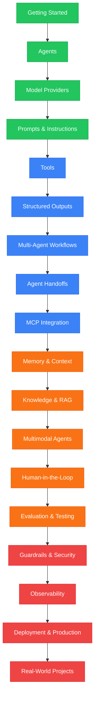

# Strands Agents Masterclass

> Venkata Bhattaram (c) 2026

An extensive, beginner-to-expert **Strands Agents Masterclass** with hands-on Python code examples — from installing Strands Agents and building your first AI agent, through model integration, tools, structured outputs, multi-agent workflows, MCP, memory, evaluation, observability, and production deployment.

This repository is designed to help you understand how to build AI applications using the Strands Agents SDK, progressing from fundamental concepts to practical, production-oriented agent systems.

## Learning Path

**Green = Beginner** &nbsp; | &nbsp; **Blue = Intermediate** &nbsp; | &nbsp; **Orange = Advanced** &nbsp; | &nbsp; **Red = Expert**

The Masterclass progressively moves from creating individual Strands agents to building complete AI applications:

**Agent → Model Provider → Prompts → Tools → Structured Outputs → Multi-Agent Workflows → Handoffs → MCP → Memory → Knowledge/RAG → Multimodal AI → Human-in-the-Loop → Evaluation → Security → Observability → Production**

## Contents

### 01. Getting Started
- [Installation](./01-get-started/code/md/installer.md01-get-started\code\md\installer.md)

